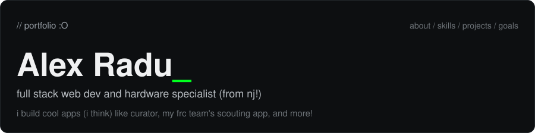
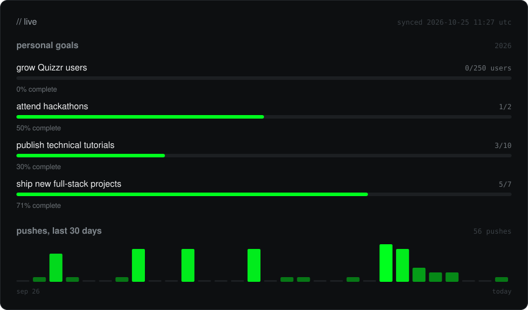

i'm a junior at pascack hills high school and i lead infotech (websites, scouting, etc) for frc team 1676, the pascack pi-oneers. this past summer i interned in the shah lab at memorial sloan kettering working on genomics pipelines. i also founded and run my school's hack club, run ysws programs (join [tagless](https://tagless.hackclub.com)), and spend my downtime in fusion 360 and bambu studio designing things and printing them.

### things i've built

- `01` **[Curator](https://curatorfrc.com)** `frc` `ai` `next js` an ai chatbot and assistant for first robotics teams. built to work alongside students, not do the work for them.
- `02` **[cont.d](https://contd.hackclub.com)** `hack club` `next js` `html` current hack club ysws: toss in an old project, pick up someone else's, and remake it.
- `03` **[tagless](https://tagless.hackclub.com)** `hack club` `javascript` `html` my first hack club ysws: build a website without a single html tag, ship it, get a prize in the mail.
- `04` **[DATAC pipeline](https://github.com/alextheradu/shahlab-nf-scatac/)** `nextflow` `nf-core` `bioinformatics` demultiplexes ATAC and WGS reads from the DATAC single-cell co-assay. built during my internship in the shah lab at mskcc.
- `05` **[Pioneer Scouting](https://github.com/PioneersTeam1676/1676-maneuver)** `react` `express` `sqlite` `dexie` full rebuild of team 1676's scouting app. works offline in a stand with no signal, with google oauth roles for pit scouts, drive teams, and leads.
- `06` **[Command](https://github.com/PioneersTeam1676/command)** `react` `express` A self-hostable team management app for FRC-style robotics teams.
- `06` **self-hosted infrastructure** `docker` `nginx` `linux` dokploy + traefik hosting my team's scouting app and a handful of side projects across a few domains, on hardware i manage myself.

also: [quizzr.org](https://quizzr.org) (<!--QUIZZR-USERS-->226<!--/QUIZZR-USERS--> users, hackathon semifinalist), [karaokly.com](https://karaokly.com), [frctree.team1676.com](https://frctree.team1676.com/), [team1676.com](https://team1676.com), [phhshack.club](https://phhshack.club)

reach me on [github](https://github.com/alextheradu), [instagram](https://www.instagram.com/al3x_r4du/), [linkedin](https://www.linkedin.com/in/al3x-radu/), or email [alex@alexradu.co](mailto:alex@alexradu.co). more at [alexradu.co](https://alexradu.co).

